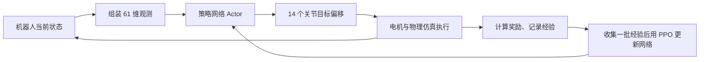

# Microduck 强化学习训练与仿真到真机迁移

Microduck RL 在物理仿真中训练一个机器人控制器：它根据身体状态和任务命令，
每隔 20 毫秒决定一次 14 个关节的目标位置，再将学到的策略导出到真实机器人运行。
下面以侧踢舞蹈任务 `Mjlab-SideKickReference-Flat-MicroDuck` 的
`lifted_sidekick_v2` 配置为例，解释训练流程、61 维输入、14 维输出和 sim-to-real gap。
数值与接口以该配置及已共享的 `model_6000` 为例，不代表实时训练进度。
启动训练、同步模型和本地推理的具体命令见[侧踢舞步训练说明](sidekick_dance_training.md)。

**先看训练过程中，一只鸭子经历了什么。**

仿真环境提供机器人模型、地面、重力、电机和碰撞。当前舞蹈任务要求鸭子按照
1.2 秒的周期左右交替侧踢，同时保持支撑脚接地、身体稳定，并尽量减少滑动、
漂移和乱跳。物理仿真由 mjlab 和 MuJoCo Warp 执行，PPO 训练使用 rsl_rl。

每个控制步执行下面的循环：



这里有两个不同的频率：

- **物理仿真为 200 Hz**：每 5 毫秒计算一次运动、碰撞和电机响应。
- **策略控制为 50 Hz**：每 20 毫秒输出一次新动作，中间执行 4 个物理步。

服务器不渲染画面时，物理计算和训练仍然照常进行。画面用于观察结果，
当前策略的输入不包含图像。

奖励由我们编写。例如 v2 的主要奖励包括脚的位置轨迹、摆动脚离地、
正确的支撑关系和身体平衡。模型尝试不同动作，环境根据实际结果评分，
PPO 再调整网络参数。各奖励项乘以权重后参与总奖励，具体定义见
[舞蹈任务配置](../src/mjlab_microduck/tasks/microduck_sidekick_reference_env_cfg.py)。

我们规定了目标节拍和脚的运动目标，实现目标所需的 14 个关节动作由策略学习。
策略能够随当前身体状态改变动作，而不是仅按时间播放固定的关节动作序列。

**PPO 如何从这些尝试中学习？**

训练时主要有两个网络：

| 网络 | 作用 | 部署时是否需要 |
| --- | --- | --- |
| Actor，策略网络 | 根据观测决定动作 | 需要 |
| Critic，价值网络 | 预测当前状态往后能获得多少累计奖励，辅助判断一次尝试是否比预期更好 | 通常不需要 |

训练中的 Actor 输出一个动作分布，从中采样动作来探索。收集一批经验后，
PPO 利用实际奖励和 Critic 的预测，增加表现比预期好的动作概率，降低表现比预期差的
动作概率，并通过裁剪目标等机制抑制过大的策略更新。它优化的是未来累计奖励，
不仅是当前一步得分。算法背景见 [PPO 原论文](https://arxiv.org/abs/1707.06347)。

例如，稍微移动重心这一瞬间可能没有直接获得踢腿奖励，但它有助于后续抬腿成功，
训练就可能逐渐保留这种动作。

共享模型对应的两卡训练配置是：

- 每张卡运行 1024 个环境，共 2048 只并行仿真鸭子，各卡协同训练同一套策略。
- 每次迭代，每个环境收集 24 个控制步。
- 一次迭代合计约 `2048 × 24 = 49,152` 条状态转换经验，再进行 PPO 更新。

日志里的一个 `iteration` 代表一轮采样和更新。每个环境一次采样覆盖
`24 × 0.02 = 0.48` 秒仿真时间，而当前任务一次 episode 最长为 8 秒，
因此一个 episode 可以跨越多次迭代；摔倒等终止条件也可能提前结束 episode。

当前 Actor 是一个普通的全连接神经网络：

```text
61 维观测 → 512 → 256 → 128 → 14 维动作
```

隐藏层使用 ELU 激活，输入带观测归一化。它是前馈网络，不使用 RNN 隐藏状态。
网络与 PPO 参数定义在
[基础任务配置的 MicroduckRlCfg](../src/mjlab_microduck/tasks/microduck_velocity_env_cfg.py)，
舞蹈配置继承该网络结构。

**接着拆开这 61 维输入。**

ONNX 输入名称为 `obs`，类型为 `float32`，形状为 `[1, 61]`。
`1` 表示一次输入一只机器人的观测，`61` 表示这次观测包含 61 个数，
不是连续 61 帧历史。

下表采用 Python 切片，右端下标不包含在内：

| 切片 | 维数 | 内容 | 真机上的来源 |
| --- | ---: | --- | --- |
| `obs[0:3]` | 3 | 身体坐标系角速度 `[ωx, ωy, ωz]`，rad/s | 身体 IMU 的陀螺仪，经坐标转换 |
| `obs[3:6]` | 3 | 身体坐标系中的单位重力方向 | IMU 姿态估计后计算 |
| `obs[6:20]` | 14 | 实际关节角度减去 HOME 角度，rad | 舵机编码器 |
| `obs[20:34]` | 14 | 关节角速度，rad/s | 舵机反馈 |
| `obs[34:48]` | 14 | 上一个控制步的原始策略输出 | 控制程序保存 |
| `obs[48:51]` | 3 | 当前舞蹈节拍 `[cosθ, sinθ, 0]` | 控制程序生成 |
| `obs[51:55]` | 4 | 头颈姿态命令，按 `neck_pitch, head_pitch, head_yaw, head_roll` 排列 | 控制程序生成，当前舞蹈部署时填零 |
| `obs[55:61]` | 6 | 身体姿态命令 `[x,y,z,roll,pitch,yaw]` | 控制程序生成，当前舞蹈部署时填零 |

维度之和为 `3 + 3 + 14 + 14 + 14 + 3 + 4 + 6 = 61`。
其中前 34 维来自传感器测量或估计，接下来 14 维是保存的动作，最后 13 维是命令。
完整部署约定记录在
[model_6000 的 metadata.json](../policies/sidekick_reference_v2/model_6000/metadata.json)。

**重力方向用来反映身体倾斜。** 身体直立时，它通常接近 `[0,0,-1]`；
身体倾斜后，重力在身体坐标系中的 x、y 分量会变化。它是单位方向，
不是原始加速度，也不是完整的世界坐标姿态；仅凭它无法确定绝对朝向 yaw。
真机上需要将 IMU 姿态与安装坐标转换正确，再把世界向下方向转换到身体坐标系。

**关节角度是相对 HOME 的偏移。** 假设某关节 HOME 为 `0.35 rad`，
编码器当前读到 `0.45 rad`，对应输入就是 `0.10 rad`。
关节顺序、正负方向和 HOME 必须与训练一致。

**上一动作提供了一点历史信息。** 它让网络知道自己刚才发出了什么指令，
保存的是原始网络输出，不是加上 HOME 后的绝对目标角度。
这不等于模型能够记住完整的历史轨迹。

**舞蹈节拍由程序提供。** 令 `t` 为开始舞蹈后经过的控制时间：

```text
θ = 2πt / 1.2
obs[48:51] = [cos(θ), sin(θ), 0]
```

使用正弦和余弦可以连续表达一个循环，避免普通计时值从周期末尾突然跳回零。
当前约定是正半周期右腿侧踢、负半周期左腿侧踢。舞蹈开始时相位为零，
命令是 `[1,0,0]`；将全部 13 维命令清零则表示舞蹈策略的 idle 状态。
在 50 Hz 控制下，每个有效控制步推进 0.02 秒，而不是按渲染帧率推进节拍。

走路策略会把同样的三个位置解释为速度命令 `[vx,vy,wz]`，所以切换策略时
也必须切换命令含义。61 维形状相同不代表任意策略都能接收相同命令值。

**头部命令为零，不代表头部不会动。** 它表达的是相对 HOME 的目标命令；
实际头颈角度已经包含在关节观测中，模型仍然可以输出头颈动作。
当前舞蹈有软性的头颈 HOME 奖励，没有把头部机械锁住。
训练中头部和身体命令保留了微小采样范围及精确零命令样本，部署舞蹈时统一填零。

这 61 维里没有摄像头图像、全局位置或直接的脚底接触信号。
脚底高度和接触状态可以用于仿真奖励、Critic 的辅助观测，Actor 则学习通过身体姿态、
关节状态和节拍控制运动。这种训练安排允许 Critic 使用部署时不容易获取的信息，
而部署只运行 Actor。

**14 维输出如何变成运动？**

输出名称为 `actions`，形状为 `[1,14]`，顺序是：

```text
0–4   左腿：left_hip_yaw、left_hip_roll、left_hip_pitch、left_knee、left_ankle
5–8   头颈：neck_pitch、head_pitch、head_yaw、head_roll
9–13  右腿：right_hip_yaw、right_hip_roll、right_hip_pitch、right_knee、right_ankle
```

当前动作转换规则是：

```text
q_target = q_HOME + 1.0 × action
```

网络输出 14 个关节的位置偏移，单位对应 rad。电机控制环根据目标位置、实际位置
以及电机动力学产生驱动力。仿真中 BAM 模拟这一过程；真实机器人由舵机固件执行
位置控制。网络输出不是直接给电机的力矩。

训练 checkpoint 用于保存和恢复训练状态；部署 ONNX 包含策略网络和观测归一化。
必须通过 [scripts/export.py](../scripts/export.py) 导出，运行时直接输入上述约定的
原始物理量，不再重复归一化。当前策略训练没有额外动作低通滤波，部署也需保持一致。

真机部署通常使用确定性的策略输出，循环读取传感器、运行网络、发送舵机目标。
此时不继续执行 PPO 更新，也不需要实时计算训练奖励。
真实机器人运行时位于 [pollen-robotics/microduck](https://github.com/pollen-robotics/microduck)，
具体部署还需要接入这里约定的舞蹈节拍。

**sim-to-real gap 指什么？**

同样的动作，在仿真和真实机器人上可能产生不同结果；同样的真实状态，
也可能被两边的观测系统表达成不同输入。这些差异就是仿真到真机的差距。

| 差距来源 | 具体例子 | 对策略的影响 |
| --- | --- | --- |
| 质量与惯量 | 实际电池位置、头部重量和模型不同 | 重心转移和摆动响应不同 |
| 电机动力学 | 电压下降、摩擦、饱和、齿轮间隙 | 目标位置到达得更慢或存在偏差 |
| 地面与接触 | 地板摩擦、脚底材料、碰撞形状不同 | 支撑脚滑动，落地反应不同 |
| 传感器 | IMU 安装偏差、编码器零位误差、噪声 | 策略误判倾斜或关节位置 |
| 时序 | 通信延迟、旧速度反馈、控制周期抖动 | 动作发出时，状态已经变化 |
| 接口约定 | 关节顺序、单位、HOME、归一化不一致 | 策略收到含义错误的数据 |

减少差距首先需要合理的物理模型和实测校准，例如确认电机响应、关节零位、
IMU 安装方向与实际控制周期。随后可通过域随机化提高对剩余误差的容忍度。

**域随机化让策略在一组不同条件下学习。** 训练时让不同环境的质量、电压、
摩擦和传感器误差有所变化，避免策略只适应一个精确模型。
这类方法的研究背景见
[Sim-to-Real Transfer of Robotic Control with Dynamics Randomization](https://arxiv.org/abs/1710.06537)。

当前配置包含：

- 质量与惯量的约 ±5% 变化，以及身体和头部质心偏移。
- 电池电压在 `6.5–8.2 V` 范围采样，并模拟负载压降。
- 电机摩擦、关节等效转动惯量等参数变化。
- IMU 安装方向误差、编码器偏置和观测噪声。
- IMU 观测延迟、关节速度反馈延迟以及执行器延迟。

电机采用 BAM XL330/M6 模型。相关实现见
[观测与随机化配置](../src/mjlab_microduck/tasks/microduck_velocity_env_cfg.py)、
[BAM 执行器配置](../src/mjlab_microduck/robot/microduck_constants.py)和
[摩擦随机化实现](../src/mjlab_microduck/actuator/friction_dr_bam.py)。
当前舞蹈任务关闭了随机推搡，所举训练版本也没有使用单独的 Backlash 变体，
不能认为所有真实误差都已覆盖。

域随机化有边界：真实硬件明显超出训练范围时，策略仍可能失败；固定的 IMU 安装偏差
需要校准；关节顺序或单位错误需要直接修正。增加训练轮数无法可靠地补偿这些接口问题。

**奖励设计不足和 sim-to-real gap 要分开排查。** 原先双脚都着地也能拿高分的问题，
在仿真内就已经存在，属于任务目标没有表达完整。域随机化不会自动补上摆动脚必须离地
的要求，所以 v2 新增了脚轨迹、离地和随相位变化的支撑关系目标。
晃头也应先检查奖励是否允许、是否与平衡有关，再分析真机动力学差异，
不能仅凭观察就认定某一种原因。

实际开发时先检查物理假设与目标姿态，再用 64 个环境、5 次迭代做 smoke test，
确认观测维度、奖励、NaN 检查和 ONNX 导出流程正常后再长时间训练。
评估时依次检查训练中的动作指标、导出 ONNX 后的闭环仿真表现、
不同初始状态与参数下的稳定性，再到真机反馈与控制时序。
服务器可做无渲染评估，本地 viewer 用于观察动作是否符合预期。

已共享 `model_6000` 的评估记录日期为 2026-10-16：三次短时 CPU MuJoCo/BAM
仿真均未摔倒，但仍有左右抬脚不对称和位置漂移；这只是有限场景的仿真结果，
该记录不包含真机验证。具体协议和结果见
[evaluation.json](../policies/sidekick_reference_v2/model_6000/evaluation.json)。
检查实际动作、支撑关系和失败情形，比只看总奖励更能说明策略学到了什么。
